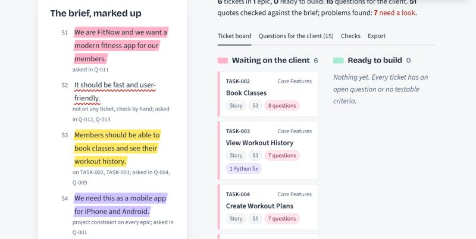
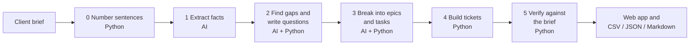
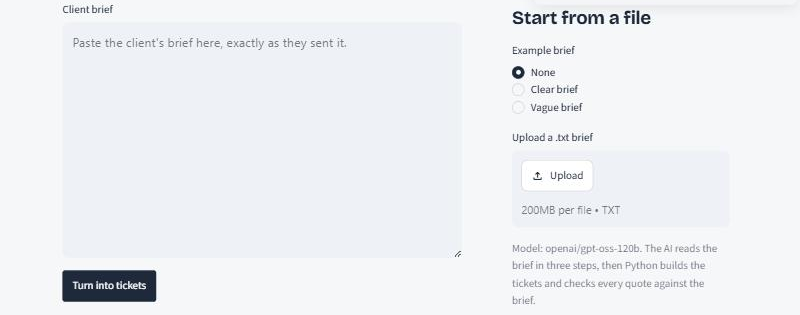
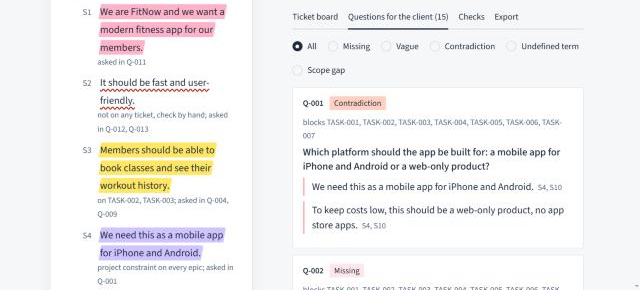
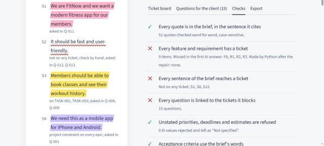

# Jira Ticket Generator: Client Brief → Dev-Ready Tickets

Paste a messy client brief and get back a developer-ready task breakdown,
Jira-style tickets and a list of questions for the client. Every ticket points
back to the sentence of the brief it came from, and anything the brief does not
say becomes a question instead of a guess.

Built for Task 1 of an AI hackathon (Project Management department: "AI-Powered
Client Brief → Dev-Ready Tasks / Jira Tickets Converter").



---

## Contents

- [The problem](#the-problem)
- [What it does](#what-it-does)
- [The golden rule: never assume](#the-golden-rule-never-assume)
- [How it works](#how-it-works)
- [Quick start](#quick-start)
- [Getting a Groq API key](#getting-a-groq-api-key)
- [Running the tool](#running-the-tool)
- [Using the web app](#using-the-web-app)
- [Output files and ticket format](#output-files-and-ticket-format)
- [Demo briefs](#demo-briefs)
- [Testing](#testing)
- [Configuration](#configuration)
- [Groq free-tier limits](#groq-free-tier-limits)
- [Troubleshooting](#troubleshooting)
- [Deploying online (optional)](#deploying-online-optional)
- [Project structure](#project-structure)
- [Tech stack](#tech-stack)
- [Known limitations](#known-limitations)
- [License](#license)
- [Author](#author)

---

## The problem

Client briefs arrive in everyday language. They mix goals with details, leave
things out and sometimes contradict themselves. A project manager reads the
brief, writes the tasks by hand and keeps going back to the client with
questions. This tool does that first pass, and it never fills a gap with an
invented detail, because a developer would build on it.

## What it does

| You give it | You get |
|---|---|
| A raw client brief (pasted, uploaded as `.txt`, or chosen from the examples) | **The brief, marked up**: every sentence highlighted by what it became (a ticket, a client question, a project constraint, or nothing) |
| | **A task breakdown**: epics split into stories and tasks |
| | **Jira-style tickets** with ID, title, type, description, acceptance criteria, source reference, dependencies, open questions, priority, estimate and deadline |
| | **Questions for the client**: missing information, vague words, contradictions, undefined terms and scope gaps, each quoting the brief and linked to the tickets it blocks |
| | **Downloads**: tickets as CSV (Jira import) and JSON, questions as CSV, and a full Markdown report |

No login or account is needed.

## The golden rule: never assume

If the brief does not say something, the tool writes `Not specified` and asks
the client. It is enforced in two layers.

**1. The prompts.** Each AI step is told to extract only what is written, to
quote the brief word for word, never to choose a side in a contradiction, never
to suggest providers, numbers or options in questions, and never to invent
acceptance criteria.

**2. Python checks, because the AI is checked, not trusted.**

| Check | What happens |
|---|---|
| Every quote must appear in the brief, in the sentence it cites (case-sensitive) | Otherwise it is flagged **UNVERIFIED** on the ticket |
| A priority, deadline or estimate is kept only if the brief states it as one | "keep costs low" is not a priority; "launch soon" is not a deadline. Both become `Not specified` |
| Acceptance criteria must use the brief's own words | A reworded criterion that adds details ("…and export reports") is replaced by the exact quote |
| A dependency is kept only if a sentence of the brief states it | Otherwise it becomes a question: "Does X depend on Y? The brief does not say." |
| Every feature must have a ticket | Missed items are sent back to the AI once; anything still missing gets a ticket built only from the brief's words |
| Every sentence of the brief must reach a ticket | Sentences that don't are listed for review |
| Ticket IDs, links and Ready / Needs clarification status | Decided by Python, never by the AI |

Every correction is listed on the ticket under **Python corrections**, so
nothing is changed silently.

## How it works



| Step | Done by | What goes in → what comes out |
|---|---|---|
| 0 Prepare | Python | brief → numbered sentences `S1, S2, …` |
| 1 Extract | AI | numbered brief → goals, users, features, constraints, quality requirements, integrations, deadlines, priorities, estimates and names, each with an exact quote and sentence number |
| 2 Find gaps | AI + Python | brief + facts → questions in five categories. Python numbers them `Q-001…` and removes any suggested answers such as "(e.g. Stripe)" |
| 3 Break down | AI + Python | facts + questions + numbered work items → epics and tasks. Python checks every item is covered and asks the AI once for anything missed |
| 4 Tickets | Python | plan → tickets `TASK-001…`, links, `Not specified` fields, status |
| 5 Verify | Python | all of the checks in the table above |

The AI is [Groq](https://groq.com) running `openai/gpt-oss-120b` in JSON mode at
temperature 0. Each AI step has its own prompt in [`prompts.py`](prompts.py)
with a role, only the context that step needs, its rules and an exact JSON
output format.

## Quick start

You need **Python 3.10 or newer**, **Git** and a free **Groq API key**.

```bash
git clone https://github.com/QURSAM-70179225/jira-ticket-generating.git
cd jira-ticket-generating

python -m venv venv
# Windows (PowerShell):
.\venv\Scripts\Activate.ps1
# macOS / Linux:
source venv/bin/activate

pip install -r requirements.txt
```

Create your `.env` file from the example and put your key in it:

```bash
# Windows (PowerShell)
Copy-Item .env.example .env
# macOS / Linux
cp .env.example .env
```

```
GROQ_API_KEY=your_groq_api_key_here
```

Start the web app:

```bash
streamlit run app.py
```

It opens at <http://localhost:8501>.

> **Windows tip:** if activating the venv says "running scripts is disabled",
> run `Set-ExecutionPolicy -Scope CurrentUser RemoteSigned` once and try again.

## Getting a Groq API key

1. Go to <https://console.groq.com> and sign in (a Google account works).
2. Open **API Keys → Create API Key** and copy the key (it starts with `gsk_`).
3. Paste it into `.env` as shown above.

Never put the key in code, in a commit or in a chat. `.env` is listed in
`.gitignore`, so Git will not upload it.

## Running the tool

| Command | What it does |
|---|---|
| `streamlit run app.py` | Opens the web app in your browser |
| `python run_demo.py` | Runs both demo briefs and saves all outputs to `outputs/` |
| `python run_demo.py vague` | Runs only the briefs whose name contains "vague" |
| `python pipeline.py briefs/clear_brief.txt` | Runs one brief from the command line |
| `python tests/offline_check.py` | Tests all the Python steps; needs no API key or internet |

A full run of one brief takes about 30–90 seconds (longer if the free-tier
limit makes it wait).

## Using the web app



1. **Give it a brief.** Paste it, upload a `.txt` file, or pick *Clear brief* or
   *Vague brief* under *Start from a file*.
2. **Click _Turn into tickets_.** The steps appear as they run.
3. **Read the marked-up brief** on the left:
   yellow = became a ticket, pink = only asked about, lilac = project
   constraint, red wavy underline = not on any ticket (check by hand).
   The small line under each sentence names its tickets and questions.
4. **Use the tabs** on the right:
   - **Ticket board**: *Waiting on the client* and *Ready to build*. Pick a
     ticket under *Open a ticket* to see every field, its criteria, its open
     questions and any Python corrections.
   - **Questions for the client**: filter by type and download them as CSV to
     send to the client.

     

   - **Checks**: each check passed or failed in plain words, plus everything
     that was flagged.

     

   - **Export**: tickets as CSV for Jira and as JSON, questions as CSV, and the
     full Markdown report.
5. **Saved runs** (left sidebar) opens any earlier result from `outputs/`
   without calling the AI, which is useful when the daily limit is used up.

## Output files and ticket format

`python run_demo.py` saves one folder per brief in `outputs/`:

| File | Contents |
|---|---|
| `report.md` | Numbered brief, open questions, task breakdown, every ticket and the verification summary |
| `tickets.csv` | One row per ticket; imports into Jira |
| `tickets.json` | The same tickets plus all open questions |
| `open_questions.csv` | The questions to send to the client |
| `result_full.json` | Everything every step produced, for review |

Every ticket has the same fields:

| Field | Contents |
|---|---|
| Ticket ID | `TASK-001`, `TASK-002`, … generated by Python |
| Title | Short, action-oriented summary |
| Type | Epic, Story or Task |
| Parent | The epic the ticket belongs to |
| Status | **Ready for development** (no open questions, testable criteria) or **Needs clarification** (with the reason) |
| Description | What to build, in the brief's words |
| Acceptance criteria | Testable conditions quoted from the brief, each with its sentence number. Epics also list project constraints |
| Source reference | The sentence the ticket comes from, e.g. `S6: "Pickup time slots are every 30 minutes…"` |
| Dependencies | Other ticket IDs, only where the brief states the link |
| Open questions | Questions that must be answered before work starts |
| Priority, Estimate, Deadline | Only if the brief states them, with the quote; otherwise `Not specified` |
| Warnings | Anything the verification flagged |
| Python corrections | Every change Python made to the AI's output |

**Importing into Jira:** in Jira choose *Import issues from CSV*, then map
*Title → Summary*, *Type → Issue Type* and *Description → Description*. The other
columns can be mapped to custom fields or appended to the description.

Example ticket (JSON, shortened):

```json
{
  "ticket_id": "TASK-009",
  "title": "Generate pickup time slots",
  "type": "Story",
  "parent": "TASK-005",
  "status": "Needs clarification",
  "description": "Pickup time slots are every 30 minutes between 10:00 AM and 8:00 PM",
  "acceptance_criteria": [
    "Pickup time slots are every 30 minutes between 10:00 AM and 8:00 PM [S6]"
  ],
  "source_reference": "S6: \"Pickup time slots are every 30 minutes between 10:00 AM and 8:00 PM\"",
  "dependencies": [],
  "open_questions": ["Q-004: What is the allowed range of pickup dates that customers can select?"],
  "priority": "highest (S13: \"The menu and ordering pages are the highest priority.\")",
  "estimate": "Not specified",
  "deadline": "15 December 2026 (S14: \"The website must go live by 15 December 2026.\")"
}
```

## Demo briefs

| File | What it is |
|---|---|
| [`briefs/clear_brief.txt`](briefs/clear_brief.txt) | A reasonably clear brief: an ordering website for a bakery in Lahore |
| [`briefs/vague_brief.txt`](briefs/vague_brief.txt) | A deliberately vague and contradictory brief: a fitness app (mobile app *and* web-only, "fast", "secure", "soon", an unexplained "MBS system") |
| [`briefs/vague_brief_planted_issues.txt`](briefs/vague_brief_planted_issues.txt) | The answer key: the 15 problems planted in the vague brief, and what the tool must **not** do |

The results are in `outputs/clear_brief/` and `outputs/vague_brief/`.

## Testing

```bash
python tests/offline_check.py
```

51 checks of the Python steps with no API key or internet, including real
errors seen in earlier runs: a quote with a wrong capital letter, a quote with
a missing word, invented priorities and deadlines, reworded acceptance
criteria, a dependency the brief does not state, malformed AI answers, and a
fake run where the AI misses features and the repair step fills them.

The full history of tests, errors found and fixes (with scores against the
answer key) is in [`review_log.md`](review_log.md).

## Configuration

Set these in `.env`:

| Variable | Required | Default | Meaning |
|---|---|---|---|
| `GROQ_API_KEY` | yes | — | Your Groq API key |
| `GROQ_MODEL` | no | `openai/gpt-oss-120b` | Any Groq chat model with JSON mode, e.g. `openai/gpt-oss-20b` |
| `GROQ_TPM_LIMIT` | no | `8000` | Tokens per minute your Groq plan allows |

The tool reads `.env` from the project folder first, then from the folder above it.

## Groq free-tier limits

- **Per minute (about 8,000 tokens):** the tool keeps every request under the
  limit and waits automatically when it is reached, printing
  `(rate limit reached, waiting 20s and retrying)`.
- **Per day (about 200,000 tokens for `gpt-oss-120b`):** one brief uses roughly
  25,000–30,000 tokens. When the daily limit is reached the run stops with a
  clear message saying when to try again. Wait, switch `GROQ_MODEL` to another
  model, or open a saved run in the web app.

## Troubleshooting

| Message | Fix |
|---|---|
| `GROQ_API_KEY is not set` | Create `.env` in the project folder with your key (see [Quick start](#quick-start)) |
| `401 Invalid API Key` | The key is wrong, or `.env` has quotes or spaces around it |
| `Request timed out` / `handshake operation timed out` | A slow connection. Run again, or try another network |
| `Groq's daily token limit … is used up` | Wait for the time shown, or set `GROQ_MODEL` to another model |
| `streamlit` / `python` is not recognized | Activate the venv first; on Windows check Python is on PATH |
| `running scripts is disabled on this system` | `Set-ExecutionPolicy -Scope CurrentUser RemoteSigned` |
| The page looks plain or uses a different font | The fonts load from Google Fonts; without internet the system font is used |

## Deploying online (optional)

You can host the web app for free on [Streamlit Community Cloud](https://streamlit.io/cloud):

1. Push this repository to GitHub (already done if you are reading this there).
2. On Streamlit Community Cloud choose **New app**, pick this repository, branch
   `main` and main file `app.py`.
3. Under **Advanced settings → Secrets** add:
   ```toml
   GROQ_API_KEY = "your_groq_api_key_here"
   ```
4. Deploy. Anyone with the link can use it without logging in, and every run
   uses your Groq quota.

## Project structure

```
jira-ticket-generating/
├── app.py                 Streamlit web app (marked-up brief, ticket board, questions, checks, export)
├── pipeline.py            Steps 0–3: numbering, AI calls, output clean-up, coverage check and repair
├── prompts.py             One prompt per AI step: role, rules, exact JSON format
├── tickets.py             Step 4: builds tickets and enforces "never assume" in Python
├── verify.py              Step 5: checks quotes, sentence references, coverage, links, unused sentences
├── export.py              JSON, CSV and Markdown output
├── run_demo.py            Runs the demo briefs and saves all outputs
├── tests/
│   └── offline_check.py   51 offline tests of the Python steps
├── briefs/
│   ├── clear_brief.txt
│   ├── vague_brief.txt
│   └── vague_brief_planted_issues.txt   answer key for the vague brief
├── outputs/               Saved demo results (report, tickets, questions, full JSON)
├── docs/screenshots/      Screenshots used in this README
├── .streamlit/config.toml Web app theme
├── review_log.md          Every test, error found and fix, step by step
├── requirements.txt       Python packages
├── .env.example           Template for your .env file
├── .gitignore             Keeps .env, venv and caches out of Git
└── LICENSE                MIT License
```

## Tech stack

| Part | Used |
|---|---|
| Language | Python 3 |
| AI | Groq API, `openai/gpt-oss-120b` (JSON mode, temperature 0) via the `groq` package |
| Web app | Streamlit, with custom CSS (Bricolage Grotesque and Instrument Sans fonts) |
| Config | `python-dotenv` |
| Tables | `pandas` |
| Everything else | Python standard library (`re`, `json`, `csv`, `unicodedata`) |

## Known limitations

- LLM output varies a little between runs, even at temperature 0 (for example,
  how many questions are asked). The checks run on every result for this reason.
- Python checks that a dependency's quote is real, not that the quoted sentence
  really implies the link; the quote is shown so a reviewer can judge.
- Duplicate questions are caught only when the wording is identical.
- The sentence splitter is simple: it splits on `.`, `!` and `?`, so an
  abbreviation such as "e.g." inside a brief can split a sentence in two.
- Smaller models follow the prompt rules less reliably. The checks make their
  mistakes visible, but `openai/gpt-oss-120b` gives the best results.

## License

Released under the [MIT License](LICENSE). You may use, copy, change and share
it, including commercially, as long as the copyright notice is kept.

## Author

**Qursam Bibi**, B.S. Information Engineering Technology, The University of Lahore
GitHub: [@QURSAM-70179225](https://github.com/QURSAM-70179225)

Issues and suggestions are welcome through
[GitHub Issues](https://github.com/QURSAM-70179225/jira-ticket-generating/issues).

This tool was built with the help of an AI assistant, stage by stage, with every
step tested and reviewed; see [`review_log.md`](review_log.md).
